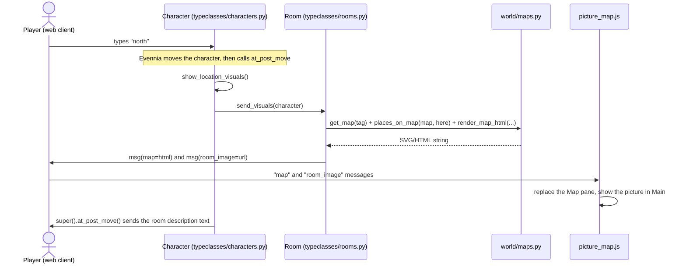

# Design

A developer's guide to how this game is built on Evennia: which parts are Evennia's, which are
ours, and what each of our files and classes does. Setup and running are in
[BUILD.md](BUILD.md); game ideas are in [IDEAS.md](IDEAS.md).

So far the game has one general feature, **picture maps and room pictures**. Actual game
content (maps, rooms, pictures) belongs on the game branches. A small **map demo** that shows
the feature working is kept outside `main` (see [section 7](#7-the-map-demo)).

## 1. Evennia in brief

Only the concepts this code uses.

**Two processes.** `evennia start` runs the **Portal**, which holds the network connections
(telnet on 4000, web on 4001, websocket on 4002), and the **Server**, which runs the game. They
talk to each other over a local socket. `evennia reload` restarts only the Server, so players
stay connected while new code loads.

**Everything in the world is a database object.** Rooms, exits, characters and things are rows
in the database (`game/server/evennia.db3`). Each row remembers which Python class it belongs
to: its **typeclass**, for example `typeclasses.rooms.Room`. Loading an object from the
database gives you an instance of that class, so behaviour lives in Python and state lives in
the database.

**State on objects:**

| Mechanism | Use | Example in this game |
|---|---|---|
| **Attribute** (`obj.db.name`, `obj.attributes.get(...)`) | Any value stored on one object (it is pickled) | a room's `map_pos` and `image` |
| **Tag** (`obj.tags.add(key, category=...)`) | A cheap label, made for searching many objects at once | "this room is on map `my_sea`" |

**Hooks.** Evennia calls fixed methods on objects when things happen: `at_post_move` after a
move, `at_post_puppet` when a player takes control of their character, `at_object_creation`
once at creation, and so on. You customise behaviour by overriding hooks in your own
typeclasses and calling `super()`.

**Messages.** `obj.msg(text="...")` sends text to whoever controls `obj`. Any other keyword
becomes a separately named message, an "outputfunc": `obj.msg(map="<div>...</div>")` sends a
message called `map`. The web client passes each one to JavaScript handlers registered for that
name. Telnet clients drop names they don't know, unless the client asked for them through GMCP
or MSDP. That is how a single call can serve both a rich web client and a plain-text client.

**The game directory overrides Evennia.** `game/` mirrors Evennia's own layout. Django looks in
`game/web/templates/` and `game/web/static/` before Evennia's files, so a file at the same
relative path *replaces* Evennia's version. That is how we customise the web client without
touching `.venv`.

**Batch processors** build worlds from files. `batchcode <python.path>` runs a Python file
found under `world/` (the `BASE_BATCHPROCESS_PATHS` setting), with the variable `caller` set to
whoever typed the command. Dotted paths reach into sub-folders: `batchcode map_demo.build` runs
`world/map_demo/build.py`.

## 2. How a move shows the map and the picture



Logging in (`at_post_puppet`) does the same, so the Map pane is filled as soon as you enter the
game. In a room that is on no map, the pane shows "No map for this place."

## 3. Python files and classes (server side)

| File | What it is |
|---|---|
| [game/world/maps.py](game/world/maps.py) | The picture-map model, map discovery and the renderer. Plain Python, no typeclasses. |
| [game/world/picture_maps/](game/world/picture_maps/__init__.py) | The package where maps are defined, one module per map. Empty on `main`. |
| [game/typeclasses/rooms.py](game/typeclasses/rooms.py) | `Room` knows its map and picture and sends them to a viewer. |
| [game/typeclasses/characters.py](game/typeclasses/characters.py) | `Character` asks its room for visuals after every move and on login. |
| [game/world/tests.py](game/world/tests.py) | Tests for discovery, rendering and the hooks. |

**`world/maps.py`**
- `PictureMap`: a static map picture with `key`, `title`, `image_url`, `width` and `height`.
  Coordinates on it are picture pixels, with (0, 0) at the top left.
- `discover_maps()`, `all_maps()`, `get_map(key)`: maps are found automatically. Every module in
  `world/picture_maps/` that has a `PICTURE_MAPS: list[PictureMap]` is imported the first time
  a map is looked up, and the result is cached until the next `evennia reload`. A key defined
  twice is an error. So a game branch adds a map by **adding a file**, without editing any
  file that `main` also has.
- `MAP_TAG_CATEGORY = "map"`: the tag category that puts a room on a map.
- `map_pos_of(room)`: reads a room's `map_pos` attribute as `(x, y)`.
- `MapPlace`, `places_on_map(map, here)`: finds every room tagged with the map's key (one
  database query through `search_tag`) and marks the one that is `here`.
- `render_map_html(map, places)`: builds an inline SVG drawing. The map picture is the
  background, each place gets a dot and a label, and the current place gets a red ring and
  "You are here". All text is HTML-escaped, so a room name can never inject markup.
- `render_no_map_html()`: what the pane shows in a room that is on no map.

The map is drawn on the server so the browser needs no game logic. The JavaScript only puts
HTML where it belongs.

**`typeclasses/rooms.py`: `Room`**
- `picture_map` (property): the first known map whose key is among the room's `map` tags, or
  `None`. A room tagged with a map that no module defines simply has no map.
- `image_url` (property): the room's `image` attribute, or `None`.
- `send_visuals(viewer)`: sends `map=...` and, if there is a picture, `room_image=...`.

**`typeclasses/characters.py`: `Character`**
- `show_location_visuals()`: calls `send_visuals` on the current room, or clears the Map pane if
  the location is not one of our `Room`s.
- `at_post_move(...)`: shows the visuals *before* calling `super()`, so the picture appears
  above the room description that Evennia's default hook sends.
- `at_post_puppet(...)`: the same on login.

Existing characters and rooms are already instances of these classes, because Evennia's
settings point the default typeclasses at `typeclasses.characters.Character` and
`typeclasses.rooms.Room`. Rooms made with `dig` get the features automatically.

## 4. Web client files (browser side)

| File | What it is |
|---|---|
| [game/web/static/webclient/js/plugins/picture_map.js](game/web/static/webclient/js/plugins/picture_map.js) | Web client plugin with handlers for the `map` and `room_image` messages. |
| [game/web/static/webclient/js/plugins/goldenlayout_default_config.js](game/web/static/webclient/js/plugins/goldenlayout_default_config.js) | Replaces Evennia's default layout and adds the Map pane. |
| [game/web/templates/webclient/webclient.html](game/web/templates/webclient/webclient.html) | Replaces Evennia's page template, only to load `picture_map.js`. |
| [game/web/static/webclient/css/custom.css](game/web/static/webclient/css/custom.css) | Styles for the room picture and the map title. |

Pictures for game content go under `game/web/static/terrific_travel/<something>/` and are
served at `/static/terrific_travel/<something>/...`.

**How Evennia's web client works:** the page loads a list of JavaScript **plugins**. Each
registers itself with `plugin_handler.add(name, plugin)` and gets `init()` called when the page
is ready. Panes are managed by the **GoldenLayout** library. Each pane has a `types` list (which
message types it shows) and an `updateMethod` (`newlines`, `append` or `replace`).

- **Layout:** our default config puts the Map pane (an `evennia` component with
  `types: "map"`, `updateMethod: "replace"`) to the right of Main. GoldenLayout remembers each
  browser's last layout in `localStorage`, which would hide a changed default from returning
  players. The `LAYOUT_VERSION` constant at the top of the file makes each browser forget its
  saved layout once. **Bump it whenever you change the layout.**
- **Plugin:** `picture_map.js` registers `Evennia.emitter.on("map", ...)` and
  `on("room_image", ...)`. The `map` handler replaces the content of every pane whose types
  include `map`. It looks for those panes itself, because Evennia's generic router would send
  the map to the Main pane whenever the player has closed the Map pane. The `room_image`
  handler adds an `` to wherever untagged text goes (normally Main) and scrolls down once
  the image has loaded.
- **Template:** `webclient.html` is Evennia's own template with one added `<script>` tag. When
  upgrading Evennia, compare it with
  `.venv/Lib/site-packages/evennia/web/templates/webclient/webclient.html`.

Static files are copied into the server's static folder on every `evennia start` and
`evennia reload`. After changing JS, CSS or images, reload the server and refresh the browser
(Ctrl+F5 if the browser still shows the old file).

## 5. Adding a map and places (what a game branch does)

1. Put the map picture under `game/web/static/terrific_travel/<game>/`.
2. Add a module `game/world/picture_maps/<game>.py` with `PICTURE_MAPS = [PictureMap(...)]`,
   giving the picture's size in pixels (the package docstring has an example).
3. `evennia reload`, then put rooms on it, in the game or from a batch file:

```
tag here = my_sea:map                                   put this room on the map "my_sea"
set here/map_pos = (400, 300)                           its position on the map picture
set here/image = "/static/terrific_travel/my_game/cove.png"  its picture (optional)
```

The one habit from [CLAUDE.md](CLAUDE.md) holds here: everything in a picture also exists as
text. Room names and exits are in the description, so a telnet player loses nothing.

## 6. Tests

`EvenniaTest` (from `evennia.utils.test_resources`) creates a fresh test database with two
rooms (`room1`, `room2`), an exit, two characters (`char1`, `char2`) and accounts for every
test. Setting `character_typeclass` and `room_typeclass` on the test class makes these fixtures
our own classes.

| Test class | Checks |
|---|---|
| `TestMapDiscovery` | Whatever maps exist in `world/picture_maps/` load without errors. |
| `TestRenderMap` | Labels are escaped; "You are here" appears once. |
| `TestRoomVisuals` | Moving into a map room sends `map` and `room_image`; a room on no map clears the pane. Registers its own `TEST_MAP` with `patch.dict` and captures what is sent with `patch.object` on `char1.msg`. |
| `typeclasses/tests.py` | Smoke test: the fixtures are this game's typeclasses. |

Run them from `game/` with `uv run evennia test --settings settings.py .`. Tests in any
`tests.py` of a package under `game/` (for example `world/map_demo/tests.py`) are found too.

## 7. The map demo

A throw-away example of the feature: three placeholder rooms (Harbour, Lighthouse, Cove) on a
placeholder map. It is not part of `main`. Where it is kept, it consists of exactly three
things:

- `game/world/map_demo/`: `builder.py` (creates and removes the rooms and exits, all tagged
  `map_demo` so removal is one search), the batch files `build.py` and `remove.py`, and
  `tests.py`, which also runs both batch files through Evennia's real `BATCHCODE` processor;
- `game/world/picture_maps/demo_sea.py`: its map;
- `game/web/static/terrific_travel/map_demo/`: its placeholder pictures.

In the game: `batchcode map_demo.build`, then `harbour` to go there; `batchcode
map_demo.remove` to delete it. To drop the demo, remove it in the game first, then delete the
three items above.

## 8. What the code deliberately does not do

- **No custom commands.** Moving and looking are Evennia's defaults. Only the hooks that run
  after them changed.
- **No coordinate-based movement.** Rooms and exits are normal Evennia rooms. `map_pos` only
  says where to draw a room. Evennia's `wilderness` and `xyzgrid` contribs exist if a future
  game wants real coordinates.
- **No map for telnet.** It would be easy to add later, as a `map` command that lists the places
  as text.
